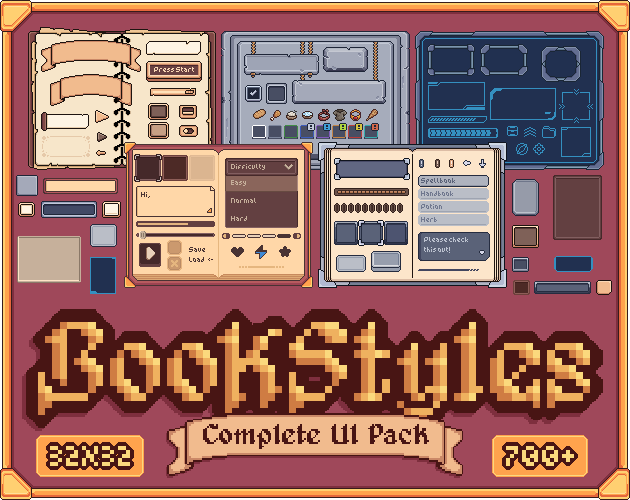

# 11. Tab Switch

Content fades/slides while the tab indicator glides.

**Roblox recipe (from general Roblox knowledge, not tested in Studio):** tween indicator Position, swap pages with CanvasGroup.

Back to the [catalog](../ANIMATIONS.md).

## Pictures

*Complete UI Book Styles Pack* by Crusenho, [source page](https://crusenho.itch.io/complete-ui-book-styles-pack). Preview image, all rights with the creator.

## Find more references
- [Google Images](https://www.google.com/search?tbm=isch&q=roblox+Tab+Switch+animation)
- [YouTube](https://www.youtube.com/results?search_query=roblox+Tab+Switch+animation)
- [Pinterest](https://www.pinterest.com/search/pins/?q=roblox+Tab+Switch+animation)
- [Behance](https://www.behance.net/search/projects?search=Tab+Switch+animation)
- [Dribbble](https://dribbble.com/search/Tab+Switch+animation)
