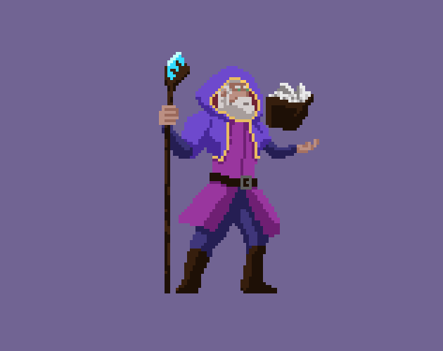

# 27. Cast Spell

Wind-up, release, recovery with hand glow.

**Roblox recipe (from general Roblox knowledge, not tested in Studio):** markers drive projectile spawn.

Back to the [catalog](../ANIMATIONS.md).

## Pictures

*Wizard Pack (CC0)* by LuizMelo, [source page](https://luizmelo.itch.io/wizard-pack). Preview image, all rights with the creator.

*Wizard Pack (CC0)* by LuizMelo, [source page](https://luizmelo.itch.io/wizard-pack). Preview image, all rights with the creator.

## Find more references
- [Google Images](https://www.google.com/search?tbm=isch&q=roblox+Cast+Spell+animation)
- [YouTube](https://www.youtube.com/results?search_query=roblox+Cast+Spell+animation)
- [Pinterest](https://www.pinterest.com/search/pins/?q=roblox+Cast+Spell+animation)
- [Behance](https://www.behance.net/search/projects?search=Cast+Spell+animation)
- [Dribbble](https://dribbble.com/search/Cast+Spell+animation)
