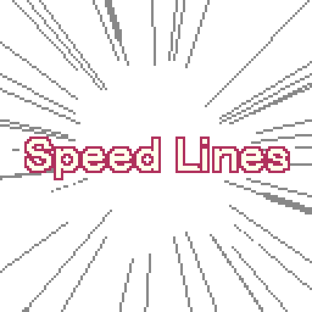

# 29. Dash and Slide

Burst dash with stretched pose and speed lines.

**Roblox recipe (from general Roblox knowledge, not tested in Studio):** LinearVelocity + animation + VFX.

Back to the [catalog](../ANIMATIONS.md).

## Pictures

*Animated Speed Line* by Heosphorus, [source page](https://heosphorus.itch.io/speed-line). Preview image, all rights with the creator.

## Find more references
- [Google Images](https://www.google.com/search?tbm=isch&q=roblox+Dash+and+Slide+animation)
- [YouTube](https://www.youtube.com/results?search_query=roblox+Dash+and+Slide+animation)
- [Pinterest](https://www.pinterest.com/search/pins/?q=roblox+Dash+and+Slide+animation)
- [Behance](https://www.behance.net/search/projects?search=Dash+and+Slide+animation)
- [Dribbble](https://dribbble.com/search/Dash+and+Slide+animation)
