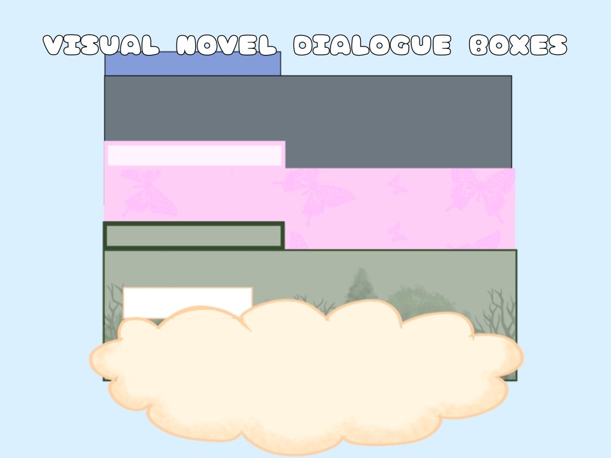

# 17. Visual-Novel Dialogue Scene

Portrait, name tag, typewriter text, choices.

**Roblox recipe (from general Roblox knowledge, not tested in Studio):** text reveal loop, remote events for choices.

Back to the [catalog](../CUTSCENES.md).

## Pictures

*Visual Novel Dialogue GUI Asset Pack* by One Level Studio, [source page](https://onelevelstudio.itch.io/dialogue-gui). Preview image, all rights with the creator.

*Visual Novel Dialogue Boxes* by charcoalstudios, [source page](https://charcoalstudios.itch.io/visual-novel-dialogue-boxes). Preview image, all rights with the creator.

## Docs and references
- [DevForum: CutsceneService](https://devforum.roblox.com/t/cutsceneservice/3283407)

## Find more references
- [Google Images](https://www.google.com/search?tbm=isch&q=roblox+Visual-Novel+Dialogue+Scene+cutscene)
- [YouTube](https://www.youtube.com/results?search_query=roblox+Visual-Novel+Dialogue+Scene+cutscene)
- [Pinterest](https://www.pinterest.com/search/pins/?q=roblox+Visual-Novel+Dialogue+Scene+cutscene)
- [Behance](https://www.behance.net/search/projects?search=Visual-Novel+Dialogue+Scene+cutscene)
- [Dribbble](https://dribbble.com/search/Visual-Novel+Dialogue+Scene+cutscene)
