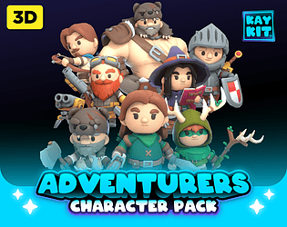
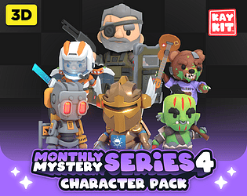
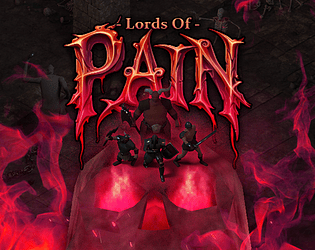
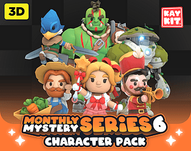
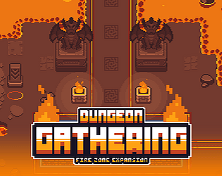
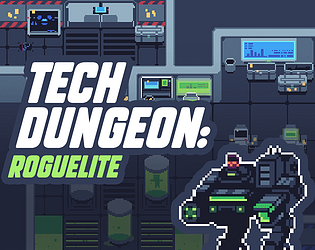

# itch.io top results: animated

Top 12 listings on  when scraped on 2026-10-20. 315x250 cover thumbnails, credited per item; all rights remain with the creators. Thumbnails are shown only as design/sound-pack references, so click through for the real assets and check each licence.

**KayKit - Character Pack : Adventurers** by Kay Lousberg: 

**KayKit - Character Pack : Skeletons** by Kay Lousberg: 

**KayKit - Character Pack : Mystery Monthly Series 4** by Kay Lousberg: 

**Lords Of Pain - Old School Isometric Assets** by Pupkin Assets: 

**KayKit - Character Pack : Mystery Monthly Series 5** by Kay Lousberg: 

**Dungeon Gathering - Under The Castle Set + Updates** by SnowHex 🌱: 

**Ultimate Platformer Pack (100+ Models)** by Quaternius: 

**LowPoly Animated Animals** by Quaternius: 

**KayKit - Character Pack : Mystery Monthly Series 6** by Kay Lousberg: 

**Dungeon Gathering - Fire Zone Expansion + Updates** by SnowHex 🌱: 

**Tech Dungeon: Roguelite - Asset Pack** by Pupkin Assets: 

**Animated Pixel Adventurer** by rvros: 
