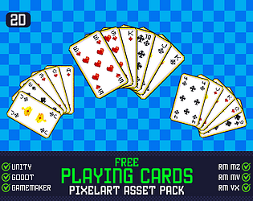
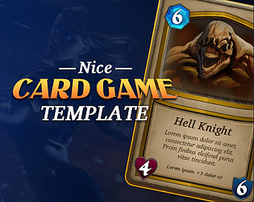
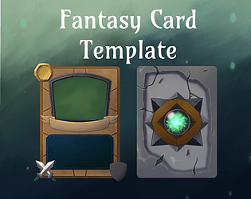
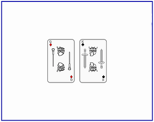
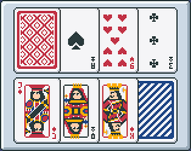
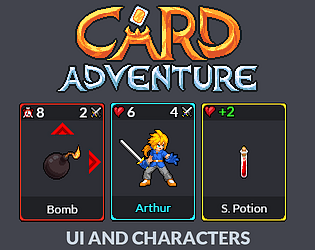

# itch.io top results: card-game + user-interface

Top 12 listings on  when scraped on 2026-10-20. 315x250 cover thumbnails, credited per item; all rights remain with the creators. Thumbnails are shown only as design/sound-pack references, so click through for the real assets and check each licence.

**Mechanized Magic: 2D Vector Cards Pack** by Dumivid: 

**Free Playing Cards Pixelart Asset Pack** by ELV Games: 

**UI Pack for a DeckBuilding Game** by Hanker: 

**KING OF GAMES | Card Game Assets** by CURSED OFFERINGS: 

**Mechanized Magic: Ultimate UI Pack** by Dumivid: 

**Pixel Card UI: Resource & PSD Kit** by IndigoLay: 

**Nice Card Game Template** by chicogames: 

**Fantasy Card Template** by Squibbls: 

**Card Deck (CC0)** by VerzatileDev: 

**Deck of Pixel Art Playing Cards** by Snoblin: 

**Card RPG) UI&Characters** by Sagak Art (Pururu): 

**Card Creator Toolkit (GUI)** by Penzilla: 
