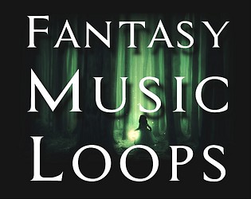
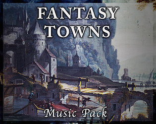
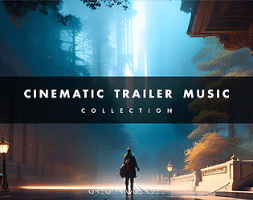
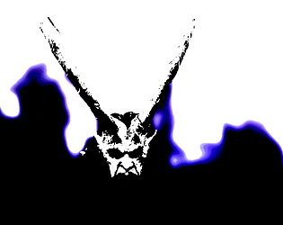

# itch.io top results: cinematic

Top 12 listings on  when scraped on 2026-10-20. 315x250 cover thumbnails, credited per item; all rights remain with the creators. Thumbnails are shown only as design/sound-pack references, so click through for the real assets and check each licence.

**Royalty Free Music Pack** by Tim Beek: 

**FANTASY MUSIC LOOPS for RPG, Adventure, Platformer, Visual Novel | Freebies Vol. 1 | Free** by FarBeyond Studio: 

**Fantasy Towns Music Pack** by Rune: 

**FREE MUSIC : Orchestral Fantasy WIZARDS 2 - 27 cinematic background music** by RUSTED MUSIC STUDIO Music & Assets: 

**FREE MUSIC CYBERSCAPES Cinematic Ambient Cyberpunk** by RUSTED MUSIC STUDIO Music & Assets: 

**Cinematic Trailer Music - Collection** by Gregor Quendel - Cinematic Sound Design: 

**Free Cyberpunk Music CYBER Tracks Vol.2** by RUSTED MUSIC STUDIO Music & Assets: 

**FREE Game Music Sampler - Vol. 1** by Tomality: 

![[FREE] Luki's Game Jam Bundle](09.png)

**[FREE] Luki's Game Jam Bundle** by lukaspfeiffermusic: 

**3 Free Viking Music Tracks - Emotional Nordic Folk (Sampler)** by AssetSmithy: 

**Sci-Fi Warp Speed Sound Library** by Shapeforms: 

**Cinematic Horror Music** by 𝚌𝚕𝚎𝚖𝚎𝚗𝚝𝚙𝚊𝚗𝚌𝚑𝚘𝚞𝚝: 
