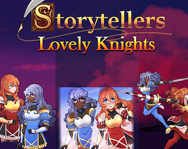
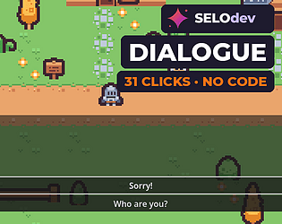
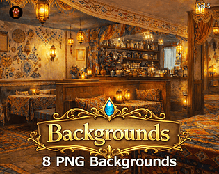
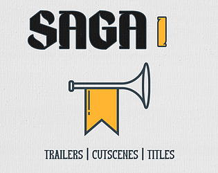
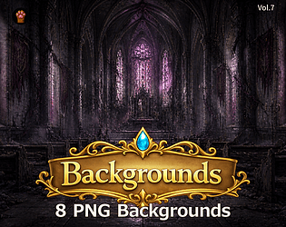
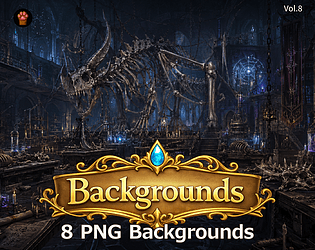

# itch.io top results: cutscene

Top 12 listings on  when scraped on 2026-10-20. 315x250 cover thumbnails, credited per item; all rights remain with the creators. Thumbnails are shown only as design/sound-pack references, so click through for the real assets and check each licence.

**Storytellers Character Assets (Lovely Knights)** by Socks: 

**Psychronic Video Overlay Plugin (MZ)** by Psychronic: 

**Easy Listening BGM Vol.1** by AuthorSeo: 

**Dialogue - No-Code Branching Dialogue for Godot 4** by selodev: 

**CS05 — Fantasy Inn & Shop Backgrounds** by Pixel Material Studio: 

**CS02 — Fantasy World Backgrounds** by Pixel Material Studio: 

**SAGA I: Trailers, Cutscenes, & Titles** by Steven Melin: 

**Romantic Dates & Confessions - Anime Event CG Pack Vol. 1** by StarlightVisuals: 

**CS04 — Fantasy Adventure Backgrounds** by Pixel Material Studio: 

**CS07 — Dark Fantasy Sanctuary Backgrounds** by Pixel Material Studio: 

**CS08 — Dark Fantasy Forbidden Chambers Backgrounds** by Pixel Material Studio: 

**Pixel Mood Clouds & Emotions Pack** by Biruk Okami: 
