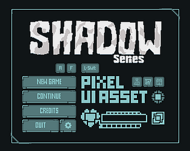
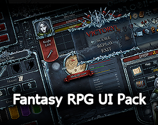
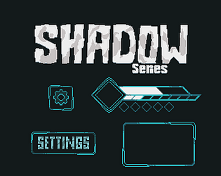
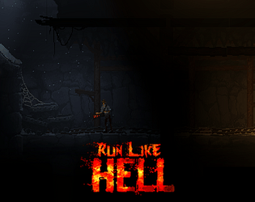
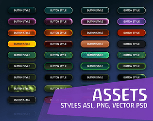

# itch.io top results: dark + user-interface

Top 12 listings on  when scraped on 2026-10-20. 315x250 cover thumbnails, credited per item; all rights remain with the creators. Thumbnails are shown only as design/sound-pack references, so click through for the real assets and check each licence.

**UI User Interface Pack - Horror** by ToffeeCraft: 

**SHADOW Series - Pixel Game UI - RPG HUD & Menu Pack** by escape-pixel: 

**Grindhaus - Horror Icon Set** by beachboogeyman: 

**Fantasy RPG UI Pack** by Moon Tribe: 

**SHADOW Series - Pixel UI - Dark Fantasy GUI Pack** by escape-pixel: 

**Ren'Py Horror/Dark UI Kit** by __ess__ VN Assets: 

**Shadow Mines - Free 2D Game Asset Pack** by waxx: 

**Dark UI Kit + Unreal Project** by IndigoLay: 

![Classic Clean UI (Ren'Py GUI Kit) [Supports multiple color themes]](09.png)

**Classic Clean UI (Ren'Py GUI Kit) [Supports multiple color themes]** by NeonStarz: 

**Assets: ASL Styles Photoshop #1** by Wenrexa: 

**Nightmare: Horror Sound Pack** by Cyrex Studios: 

**Moonlit UI and Button Pack - Part of the Moonlit Platformer Series** by Sebbyspoons: 
