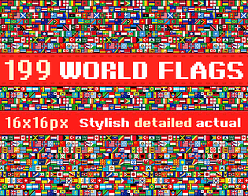
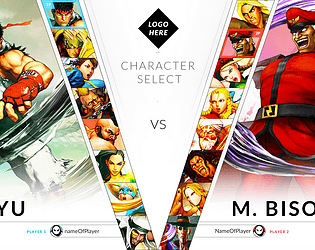
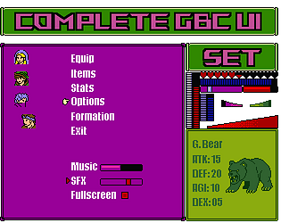

# itch.io top results: fighting + user-interface

Top 12 listings on  when scraped on 2026-10-20. 315x250 cover thumbnails, credited per item; all rights remain with the creators. Thumbnails are shown only as design/sound-pack references, so click through for the real assets and check each licence.

**FREE Pixel Combat SFX** by Helton Yan: 

**Shapeforms Audio Free Sound Effects** by Shapeforms: 

**FIGHTING GAME UIKIT-V1** by rupertBastos: 

**Beat em Up Graphics Pack** by RetroDima: 

**Pokemon Style UI Kit/ Asset Pack (PixelArt)** by Tavare Studio: 

**UI Fighting Game Asset’s Pack** by Pandora Entertainment: 

**199 DETAILED WORLD FLAGS (16x16px) for your game or project.** by TriariusKonstantinus: 

**FIGHTING GAME UIKIT PACK-V1** by rupertBastos: 

**15 128x128 nostalgic backgrounds** by Kelano Studio: 

**Knuckle Row – Street Brawler & Beat 'Em Up Action RPG UI Kit** by v2kid: 

**Complete Gameboy  Color UI and Menu Set** by goblinspire: 

**Beasts & Gods** by Kelano Studio: 
