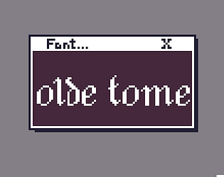
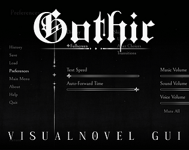
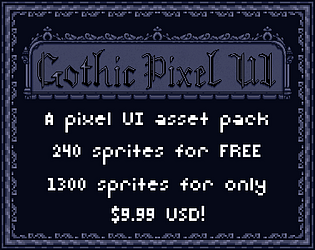
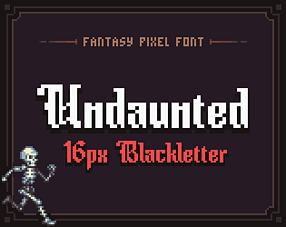
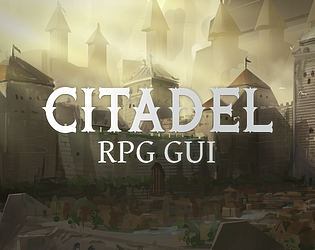
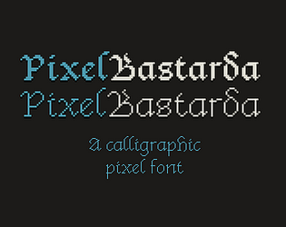
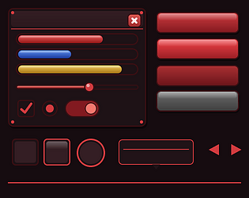

# itch.io top results: gothic + user-interface

Top 12 listings on  when scraped on 2026-10-20. 315x250 cover thumbnails, credited per item; all rights remain with the creators. Thumbnails are shown only as design/sound-pack references, so click through for the real assets and check each licence.

**Tiny RPG - Dark Dwellers GUI** by tiopalada: 

**Pixel Font - Olde Tome** by Lady Liefy: 

**Leonora Twine Template** by Lapin Lunaire Games: 

**Gothic VN GUI** by Cal ✦ Artist: 

**Gothic Pixel UI - Game Asset Pack** by AbyssOwl: 

**Undaunted - Fantasy Pixel Font** by TJ Trewin: 

**Metroidvania | UI & Icons** by Sam: 

**Citadel RPG GUI** by Kodiak Graphics: 

**Obssidian Gothic UI — Godot Ready Dark Fantasy UI Kit** by obssidian-art: 

**PixelBastarda** by Icefields: 

**DARK FANTASY UI & HUD** by NeoPixelBoyCo: 

**Crimson Dread UI Kit - 44 PNG interface elements** by uiforge: 
