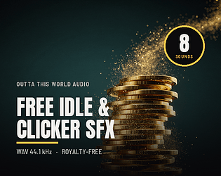

# itch.io top results: idle + user-interface

Top 12 listings on  when scraped on 2026-10-20. 315x250 cover thumbnails, credited per item; all rights remain with the creators. Thumbnails are shown only as design/sound-pack references, so click through for the real assets and check each licence.

**Casual Mobile Game UI Kit + 260 icons** by SunGraphica: 

**Town Tender - Asset pack** by Tetraminose: 

**Free Idle and Clicker Sounds - 8 Royalty-Free Click and Coin SFX** by Outta This World Audio: 

**Brightdeck UI Kit: Deckbuilder & Idle Game GUI + Godot 4 Theme** by DadddyDarko: 

**Tally — Clicker and Idle Feedback Ladders** by CSAF — Core Systems Asset Factory: 

**Free Idle & Tycoon UI Sampler – 8 Game-Ready Assets** by GoldenForgeStudios: 

**Mobile Idle & Clicker UI Kit – 18 Screens, 3 Themes + Godot 4** by Template Foundry: 

**Game UI Kit - 608 Components, PNG, SVG and 9-Slice - Glassforge** by Dmitriy o_HET: 

**Combat Log + Damage Breakdown UI** by Template Foundry: 

**Idle Gamer Simulator — Glossy Arcade GUI Kit (200+ elements)** by AuraSoft: 

**Idle and Clicker Game SFX - 30 Click, Coin and Upgrade Sounds** by Outta This World Audio: 

**Idle & Tycoon UI Starter Pack – 48 Game-Ready UI Assets** by GoldenForgeStudios: 
