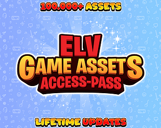
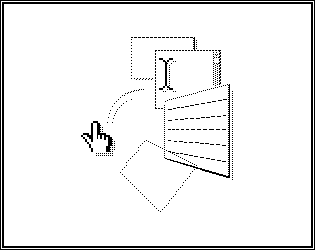
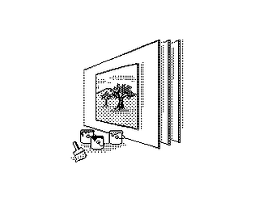
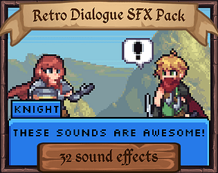
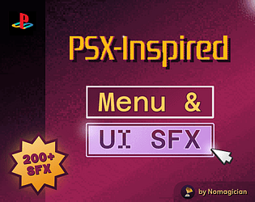
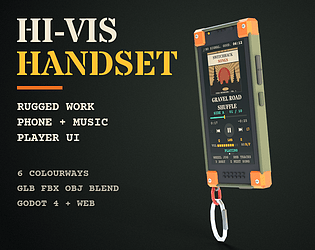
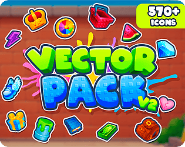

# itch.io top results: low-poly + user-interface

Top 12 listings on  when scraped on 2026-10-20. 315x250 cover thumbnails, credited per item; all rights remain with the creators. Thumbnails are shown only as design/sound-pack references, so click through for the real assets and check each licence.

**ElvGames All-Access Pass** by ELV Games: 

**Ren'Py Hypercard Framework** by Eliot Gardepe: 

**Hypercard Graphics Pack** by Eliot Gardepe: 

**Retro Dialogue SFX Pack** by Leohpaz: 

**Staff Icons 32x32 Pixelart** by ELV Games: 

**PSX & Retro  ♦ UI & Menu Sound Effects (Vol.1)** by Nomagician • Music & SFX: 

![Interactive 2D World Map for unity [based on vector graphics]](07.png)

**Interactive 2D World Map for unity [based on vector graphics]** by Naoufel: 

**HYRUN : Crowd Runner Hyper Casual Game Asset Pack** by Standout 7: 

**PS1 HORROR UI (COMPLETE)** by ROHHSA: 

![Cartoon UI Icon Pack Vol. 1 [Update]](10.png)

**Cartoon UI Icon Pack Vol. 1 [Update]** by K7_42: 

**Rugged Work Phone - 3D Model + Music Player UI - glTF, FBX, Godot 4** by Out of Tokens Studio: 

**Vector Pack v2** by Cyberdelic: 
