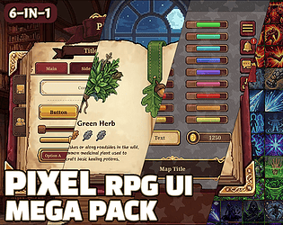

# itch.io top results: medieval + user-interface

Top 12 listings on  when scraped on 2026-10-20. 315x250 cover thumbnails, credited per item; all rights remain with the creators. Thumbnails are shown only as design/sound-pack references, so click through for the real assets and check each licence.

**UI User Interface MEGA PACK** by ToffeeCraft: 

**Fantasy UI User Interaface** by ToffeeCraft: 

**UI User Interface Pack - Medieval** by ToffeeCraft: 

**UI User Interface Pack - Medieval - Mega Version** by ToffeeCraft: 

**UI User Interface Mini Medieval Fantasy Pack** by ToffeeCraft: 

**Dark Ages UI - Pixel Art Asset Pack** by Hypnobius: 

![[8x8] Isometric TRPG Asset Pack](07.png)

**[8x8] Isometric TRPG Asset Pack** by Gustavo Vituri: 

**Pixel Font - Olde Tome** by Lady Liefy: 

**Free Medieval Fantasy UI Pack** by Kibyra: 

**Pixel RPG UI Mega Pack : 6-in-1** by IndigoLay: 

**Fantasy RPG UI** by Free Game Assets (GUI, Sprite, Tilesets): 

**Knightwood Pixel Font** by TJ Trewin: 
