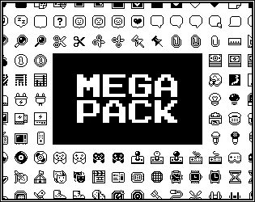
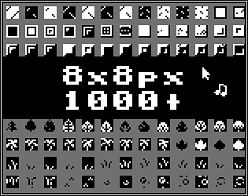
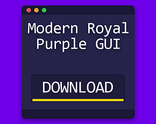
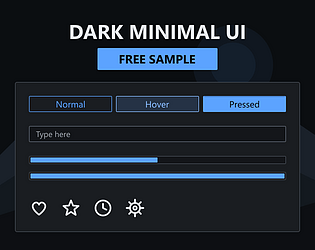
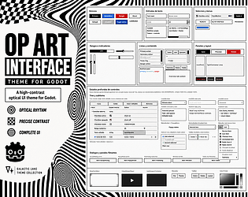
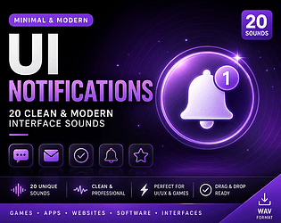
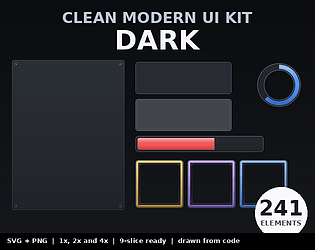
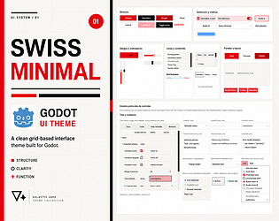

# itch.io top results: minimal + user-interface

Top 12 listings on  when scraped on 2026-10-20. 315x250 cover thumbnails, credited per item; all rights remain with the creators. Thumbnails are shown only as design/sound-pack references, so click through for the real assets and check each licence.

**Frames** by piiixl: 

**Mega Pack** by piiixl: 

**8x8px 1000+** by piiixl: 

**Modern Royal Purple GUI** by Comp-3 Interactive: 

**Dark Minimal UI - FREE Sample (SVG + PNG)** by StationSupply: 

**Dark Minimal UI - Game UI Kit (SVG + PNG)** by StationSupply: 

**Op Art Interface Godot Theme** by GalacticLake: 

**Minimal UI Notifications – 20 Clean & Modern Interface Sounds** by SoundShelf Studio: 

**Clean Modern UI Kit - Dark (241 parts)** by Taproot Solutions LLC: 

**Simple & Minimal UI Sound Effects – Game Interface SFX** by SummersSound: 

**Black & Red Twitch Panels** by fancyshards: 

**Swiss Minimal - Godot UI Theme** by GalacticLake: 
