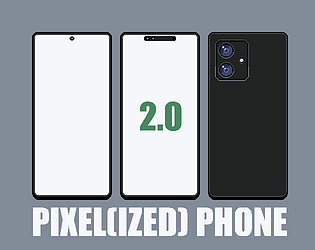
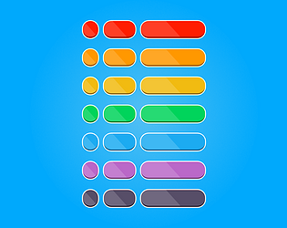
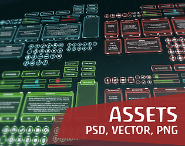
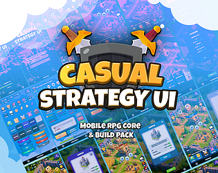

# itch.io top results: mobile + user-interface

Top 12 listings on  when scraped on 2026-10-20. 315x250 cover thumbnails, credited per item; all rights remain with the creators. Thumbnails are shown only as design/sound-pack references, so click through for the real assets and check each licence.

**Pixel Gore UI** by monogon: 

**Assets FREE: UI Casual Game Interface** by Wenrexa: 

**Pixel(ized) Phone** by Ashizian: 

**CASUAL GAME BUTTONS VOL. 02** by Vektyr: 

**Racing UI Kit - Free Game UI Asset Pack** by Ville Seppänen: 

**Assets: UI Casual Techno-Retro** by Wenrexa: 

**Casual Mobile Game UI Kit + 260 icons** by SunGraphica: 

**Ruby & Gold UI Pack** by BlackJellyCat: 

**Assets: UI Casual Game #4 VECTOR** by Wenrexa: 

**Modern and minimal game UI kit + 260 Icons** by SunGraphica: 

**Casual Strategy UI Kit - Mobile RPG Core & Build Pack** by IndigoLay: 

![Game UI [PixelArt]](12.png)

**Game UI [PixelArt]** by Yashe: 
