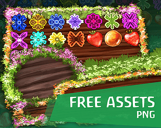
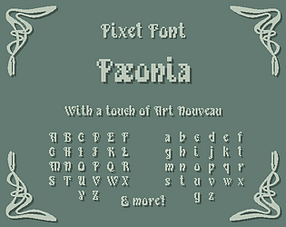
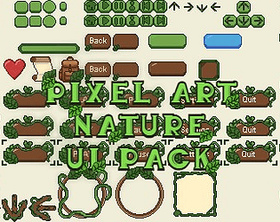
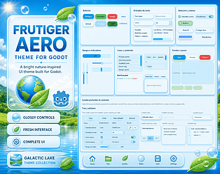
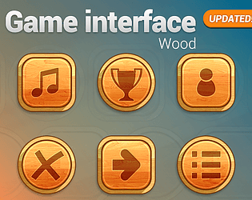
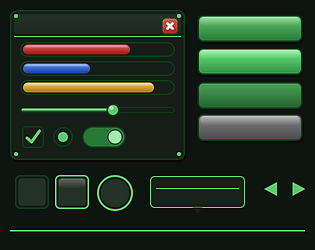

# itch.io top results: nature + user-interface

Top 12 listings on  when scraped on 2026-10-20. 315x250 cover thumbnails, credited per item; all rights remain with the creators. Thumbnails are shown only as design/sound-pack references, so click through for the real assets and check each licence.

**Assets Free: UI Casual Interface Nature** by Wenrexa: 

**UI Sound Pack** by Cyrex Studios: 

**Assets: 2D Crystal Sprites** by Wenrexa: 

**Assets: Free GUI Casual Nature** by Wenrexa: 

![Assets: Sprites Forest [Trees, Backgrounds] #2](05.jpg)

**Assets: Sprites Forest [Trees, Backgrounds] #2** by Wenrexa: 

**Floral Fantasy Pixel Font "Pæonia"** by Valiegraphie: 

**20 Druid Shapeshifting & Nature Magic - Dark Fantasy RPG Icons (Vol. 25)** by M-Xing Studio: 

**Free UI Nature Pack** by Qiuro: 

**Frutiger Aero UI – Godot Theme** by GalacticLake: 

**Game Interface: Wood** by moxica: 

**Forest Emerald UI Kit - 44 PNG interface elements** by uiforge: 

**50 RPG Magic Fire Spell Icons** by dealerdesign: 
