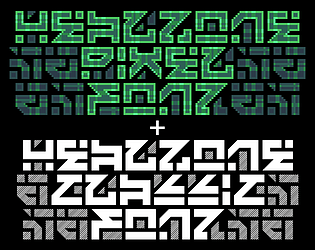
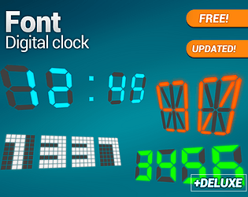
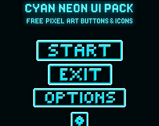
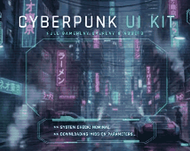
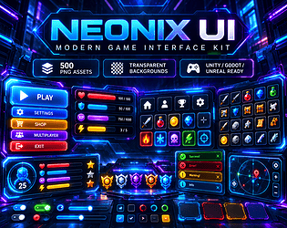
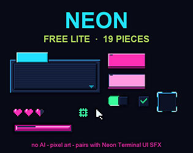
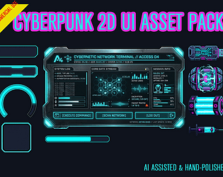

# itch.io top results: neon + user-interface

Top 12 listings on  when scraped on 2026-10-20. 315x250 cover thumbnails, credited per item; all rights remain with the creators. Thumbnails are shown only as design/sound-pack references, so click through for the real assets and check each licence.

![Assets Free Abstract Backgrounds [+202]](01.jpg)

**Assets Free Abstract Backgrounds [+202]** by Wenrexa: 

**Healzone pixel & classic fonts** by thUg-inc: 

**Fonts: digital LED clock** by moxica: 

**Cyan Neon UI Pack - Pixel Arcade Buttons** by Uryon Games: 

**Cyberpunk HUD UI Kit - Vol. 1** by DJY66 | Cyberpunk UI: 

**NEONIX UI — 500 Modern Neon Game UI Assets** by Gonken Games: 

**100 Cyberpunk Neon Items & Loot Icons - RPG Asset Pack** by GameReadyPixels: 

**Neon Glow - Pixel Font** by Bragorn: 

**Neon Pink UI Pack – Pixel Arcade Buttons** by Uryon Games: 

**Neon UI Kit Lite (19 Pixel Art Pieces, Free · No AI)** by Willosuna: 

**Cyberpunk UI Asset Pack v1** by DoDoCat: 

![[FREE] Cyberpunk UI Starter Kit & 4K Backgrounds](12.jpg)

**[FREE] Cyberpunk UI Starter Kit & 4K Backgrounds** by DJY66 | Cyberpunk UI: 
