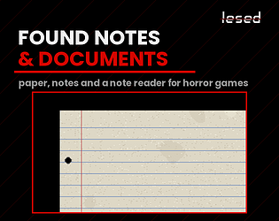
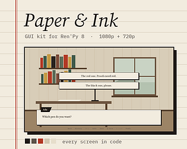
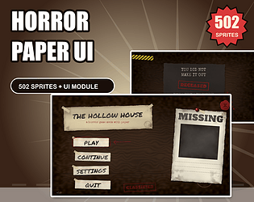
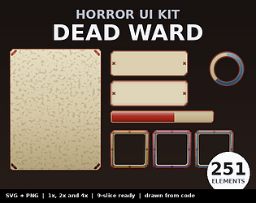

# itch.io top results: paper + user-interface

Top 12 listings on  when scraped on 2026-10-20. 315x250 cover thumbnails, credited per item; all rights remain with the creators. Thumbnails are shown only as design/sound-pack references, so click through for the real assets and check each licence.

**Paper Keys Sprite Pack V2.0** by U-GameZ: 

**UI: 01 Paper Theme** by Admurin: 

**Scroll kit** by Robert Brooks - gamedeveloperstudio.com: 

**Found Notes & Documents Kit – Pixel Paper Templates, Horror Notes & a Note Reader** by lesed: 

**Paper GUI** by ErinBrume: 

**Wood & Paper - UI Kit** by createdbyjerry: 

**Parchment UI** by Robert Brooks - gamedeveloperstudio.com: 

**Paper & Ink – GUI kit for Ren'Py** by Juliusschmidt: 

**Origami UI Kit - HUD + Strategy - 22 Screens - Godot, Unity, HTML5** by Out of Tokens Studio: 

**Horror Paper UI Kit** by Dell Create: 

**Simple Pixel Paper UI kit** by inkle: 

**Horror UI Kit - Dead Ward (251 parts)** by Taproot Solutions LLC: 
