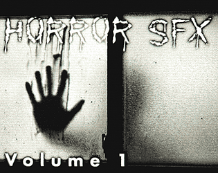
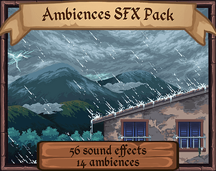
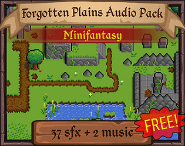
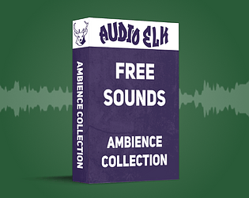
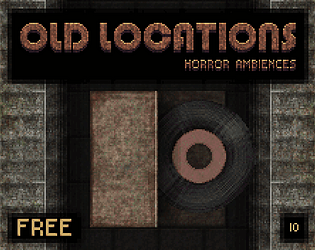

# itch.io top results: sound-effects + ambience

Top 12 listings on  when scraped on 2026-10-20. 315x250 cover thumbnails, credited per item; all rights remain with the creators. Thumbnails are shown only as design/sound-pack references, so click through for the real assets and check each licence.

**Horror SFX Volume 1** by ObsydianX: 

**Butterfly - Looped Ambience Sounds Pack** by Diablo Luna ど苛ッ: 

**Ambiences and Perspectives SFX** by Leohpaz: 

**Minifantasy - Forgotten Plains Audio Pack** by Leohpaz: 

**Horror PSX Music & FX Sounds** by Pablo Alegria: 

**DEEP AND BASSY HITS (LOW END IMPACTS)** by ROHHSA: 

**Free City & Nature Sounds** by Gregor Quendel - Cinematic Sound Design: 

**Audio Elk | Ambience Collection** by Audio Elk: 

**Old Locations (Free Horror Ambiences Asset)** by Canvas Coven: 

**Dystopia – Ambience & Drone** by Shapeforms: 

**Fantasy Sound Pack** by Cyrex Studios: 

**Small Sound Kit "Free"** by Sound Works 12: 
