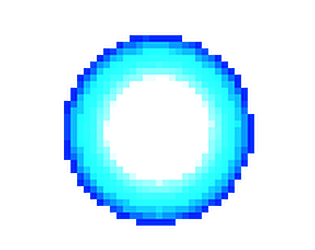
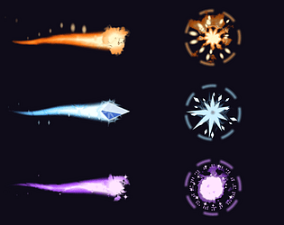
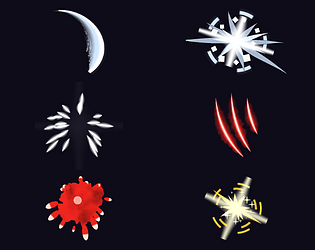
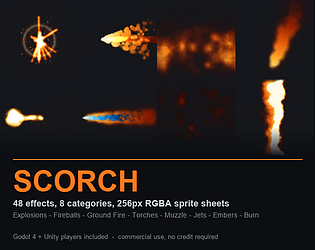
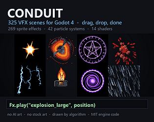
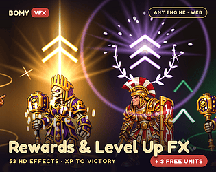
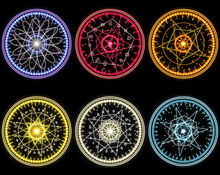

# itch.io top results: sprite-sheet + effects

Top 12 listings on  when scraped on 2026-10-20. 315x250 cover thumbnails, credited per item; all rights remain with the creators. Thumbnails are shown only as design/sound-pack references, so click through for the real assets and check each licence.

**zFree Glowing Ball Sprite Pixel FX RPG Maker Ready** by LVGames: 

**Spell FX Free - Magic VFX Sampler** by heyheythere: 

**Combat FX Free - Hit VFX Sampler** by heyheythere: 

**Abyss Bug Sprite Pack** by Arhimed122: 

**PLUME - Smoke, Dust & Debris VFX** by godboyhappy: 

**SCORCH - Fire, Explosion & Burn VFX** by godboyhappy: 

**CONDUIT - 2D VFX library for Godot 4** by godboyhappy: 

**DELUGE - Water, Splash & Liquid VFX** by godboyhappy: 

**Rewards & Level Up FX** by Bomy Games: 

**FANFARE - Pickup, Level-Up & Reward VFX** by godboyhappy: 

**Magic Circle VFX — 12 Looping Elemental Sigils (Godot 4 Ready)** by Aurum Nocturne: 

**CLEAVE - Melee Impact & Weapon VFX** by godboyhappy: 
