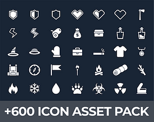
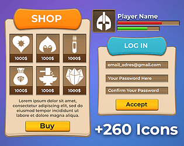
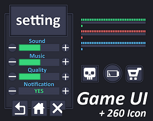
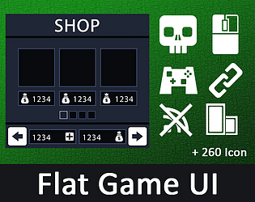
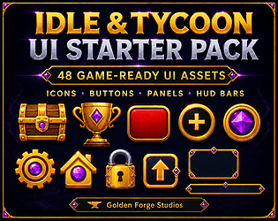

# itch.io top results: tycoon + user-interface

Top 12 listings on  when scraped on 2026-10-20. 315x250 cover thumbnails, credited per item; all rights remain with the creators. Thumbnails are shown only as design/sound-pack references, so click through for the real assets and check each licence.

**600 clean and minimal game Icons ultimate pack** by SunGraphica: 

**Line Game Icons Ultimate collection** by SunGraphica: 

**Neon Sci-Fi Interface Kit** by SunGraphica: 

**Casual Mobile Game UI Kit + 260 icons** by SunGraphica: 

**Modern and minimal game UI kit + 260 Icons** by SunGraphica: 

**Game asset UI pack + Icon collection** by SunGraphica: 

**Tycoon UI Icon pack** by GregorMack: 

**Simple Flat Game Interface Kit** by SunGraphica: 

**Free Idle & Tycoon UI Sampler – 8 Game-Ready Assets** by GoldenForgeStudios: 

**Mobile Idle & Clicker UI Kit – 18 Screens, 3 Themes + Godot 4** by Template Foundry: 

**Dispatch Deck** by Routy: 

**Idle & Tycoon UI Starter Pack – 48 Game-Ready UI Assets** by GoldenForgeStudios: 
