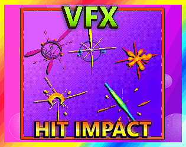
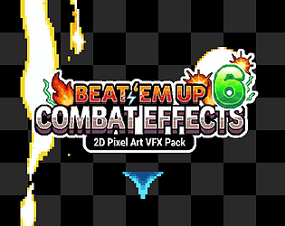
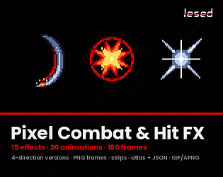
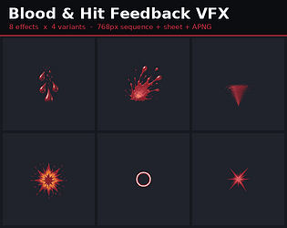
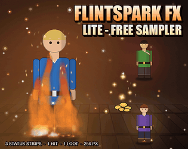

# itch.io top results: vfx + hit

Top 12 listings on  when scraped on 2026-10-20. 315x250 cover thumbnails, credited per item; all rights remain with the creators. Thumbnails are shown only as design/sound-pack references, so click through for the real assets and check each licence.

**Pixel Art VFX - Impacts - FREE Version** by Frostwindz: 

**VFX - HIT IMPACT - Pixel Art Effects** by kiddolink: 

**Combat Effects  6– 2D Pixel Art VFX Pack** by Pozac: 

**Hit VFX Pack - 30 Stylized Impact Effects for Godot 4** by berrryhibiscus: 

**Hit Impact Effects** by Travis Game Assets: 

**Pixel Art Hit Impact VFX - 8 Color Animation Pack** by Met.Pxl: 

**Pixel Combat & Hit FX – 15 Animated Effects** by lesed: 

**Hit - Effect Pixel Art** by sanctumpixel: 

**Hit 2 - Effect Pixel Art** by sanctumpixel: 

**Toon Hits & Impacts VFX - Vol. 1 (2D)** by Taproot Solutions LLC: 

**Blood & Hit Feedback VFX - Vol. 1 (2D)** by Taproot Solutions LLC: 

**Flintspark FX Lite - 5 Free Status, Hit & Loot VFX with Start, Loop & End (Godot 4 & Unity)** by spareminute: 
