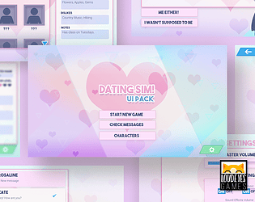
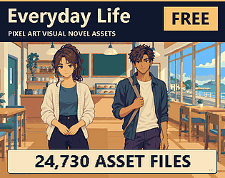

# itch.io top results: visual-novel + user-interface

Top 12 listings on  when scraped on 2026-10-20. 315x250 cover thumbnails, credited per item; all rights remain with the creators. Thumbnails are shown only as design/sound-pack references, so click through for the real assets and check each licence.

**Easy Ren'Py GUI** by Feniks: 

**Ren'Py Hypercard Framework** by Eliot Gardepe: 

**Dating Sim UI Pack** by LoudEyes: 

**Achievements for Ren'Py** by Feniks: 

**lolurio's FREE Cozy Game UI SFX Pack** by lolurio: 

**Controller Support Expansion for Ren'Py** by Feniks: 

**PIXEL FANTASY RPG ICONS - Keyboard Buttons** by Caz: 

**Disco Framework** by Katy133: 

**Everyday Life — Free Pixel Art Visual Novel Assets** by DadddyDarko: 

**Ren'Py Layered Image Masks** by Feniks: 

**Rounded RenPy GUI Kit** by NovelKit: 

**Elegant GUI kit** by Chiara: 
