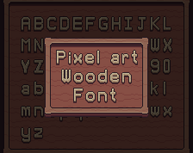
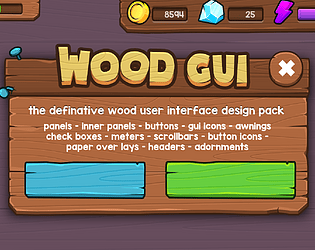
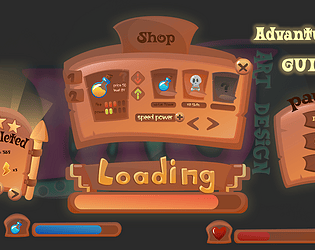
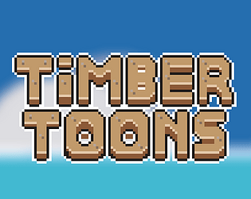
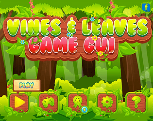

# itch.io top results: wood + user-interface

Top 12 listings on  when scraped on 2026-10-20. 315x250 cover thumbnails, credited per item; all rights remain with the creators. Thumbnails are shown only as design/sound-pack references, so click through for the real assets and check each licence.

**UI: 02 Wood Theme** by Admurin: 

**Pixel Art Wooden Font v1** by Narik: 

**Gems and Wood Fantasy GUI and Buttons Kit** by nulllgames: 

**Wood theme game GUI** by Robert Brooks - gamedeveloperstudio.com: 

**2D Game Adventure Cartoon GUI** by MarwaMJ: 

**Timber Toons GUI** by RDBI: 

**Wood & Paper - UI Kit** by createdbyjerry: 

**Faded Earth Art Pack** by Macrow: 

**Rustic UI Pixel Art** by Chotto Inc: 

**Vines and Leaves - Game GUI** by pzUH: 

**Wooden Menu Buttons (Animated)** by Nectanebo: 

**2D Game Plant Cartoon GUI** by MarwaMJ: 
