# Studs UI — visual reference library

A collection of **7 pre-existing PNG images** and **12 newly created, original SVG stud-UI concept previews** for Roblox UI inspiration. SVGs are source-editable vector illustrations, **not PNG files** and **not Roblox screenshots**.

## Existing PNG reference images (7)

| Preview | File |
| --- | --- |
| 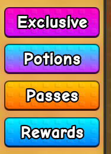 | [Stud-Buttons.png](Stud-Buttons.png) |
|  | [Stud-DailyRewards.png](Stud-DailyRewards.png) |
| 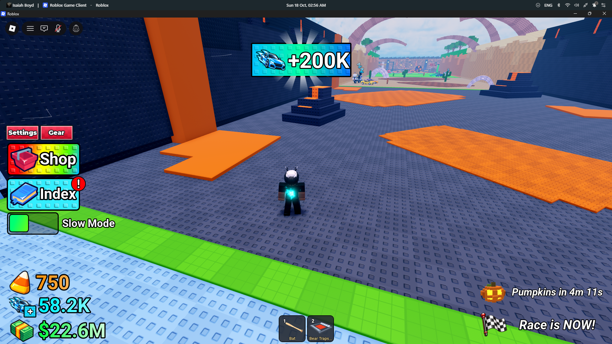 | [Stud-GUI-1.png](Stud-GUI-1.png) |
|  | [Stud-GUI-2.png](Stud-GUI-2.png) |
|  | [Stud-GUI-4.png](Stud-GUI-4.png) |
|  | [Stud-GUI-5.png](Stud-GUI-5.png) |
|  | [Stud-Shop.png](Stud-Shop.png) |

**Existing PNG rights:** origins/licences of these images were not independently established in this update. Check the original source and obtain permission before republishing or using them as production assets.

## Original stud UI concept gallery (12 SVG previews)

Each vector mockup uses layered panels, chunky outlines, embossed/stud dots and readable button regions. These are newly authored concepts for design study, not fully interactive GUIs.

| Preview | Concept | Useful tags |
| --- | --- | --- |
| 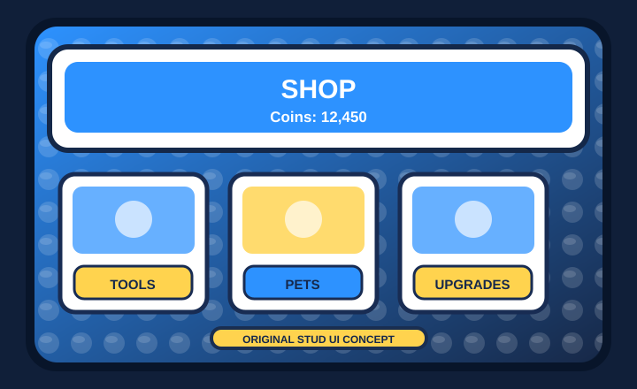 | [Simulator Shop](concepts/01-simulator-shop.svg) | simulator, shop, pricing |
| 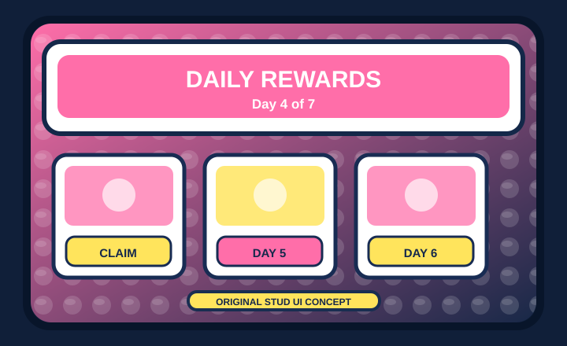 | [Daily Rewards](concepts/02-daily-rewards.svg) | daily login, progression |
| 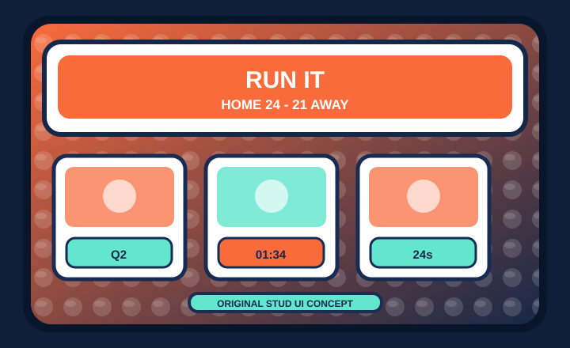 | [Basketball Scoreboard](concepts/03-basketball-scoreboard.svg) | sports, R6, competitive HUD |
| 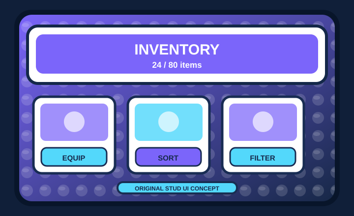 | [Inventory Grid](concepts/04-inventory.svg) | items, grid, equip |
| 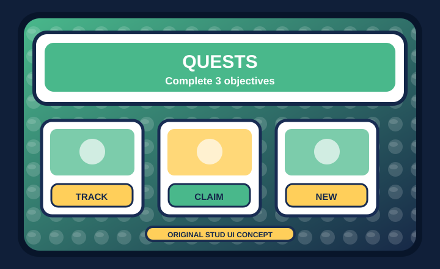 | [Quest Board](concepts/05-quest-board.svg) | tasks, progression, trackers |
| 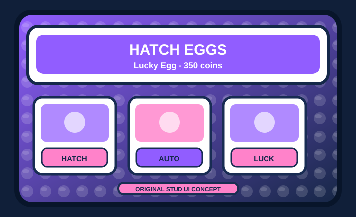 | [Pet Hatching](concepts/06-pet-hatching.svg) | simulator, pets, RNG |
| 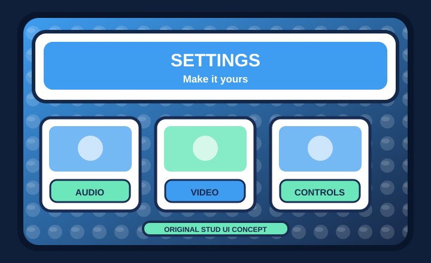 | [Settings Screen](concepts/07-settings.svg) | accessibility, preferences |
| 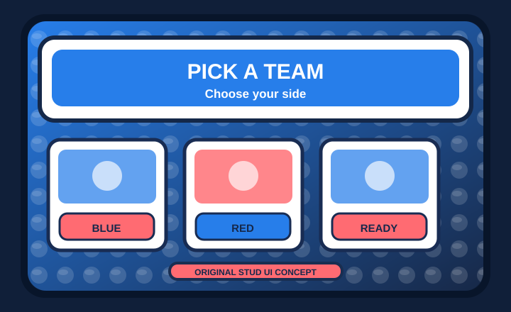 | [Team Selector](concepts/08-team-selector.svg) | sports, teams, selection |
| 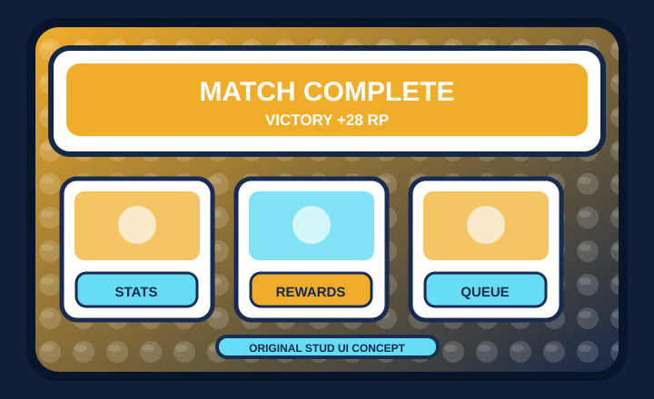 | [Ranked Results](concepts/09-ranked-results.svg) | ranked, post-match, rewards |
| 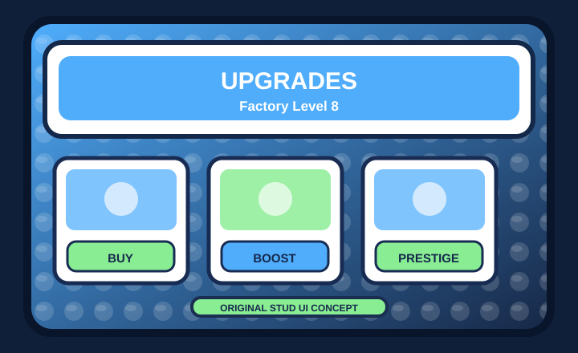 | [Tycoon Upgrades](concepts/10-tycoon-upgrades.svg) | tycoon, economy, progression |
| 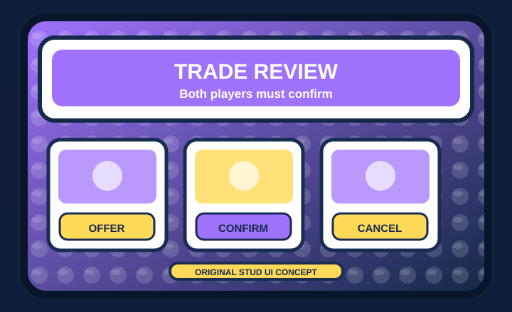 | [Trading Panel](concepts/11-trading-panel.svg) | trading, confirmations, safety |
| 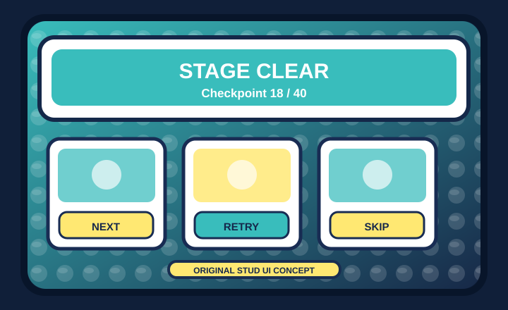 | [Obby Checkpoints](concepts/12-obby-checkpoints.svg) | obby, checkpoint, progression |

## AI assistant usage

1. Ask the assistant to inspect a *specific* SVG or PNG in this folder before implementing a design.
2. Specify your target: mobile/desktop/controller, genre, screen layout, and accessibility needs.
3. Reproduce the **visual language** in Roblox Studio using `Frame`, `UIStroke`, `UICorner`, `UIGradient`, `UIScale`, `UIListLayout`/`UIGridLayout`, and optionally `ImageLabel` for repeated studs.
4. Treat the SVG previews as design references. Roblox Studio does **not** directly import SVG as an ImageLabel asset. Rebuild the UI natively or convert artwork to an accepted image format with appropriate rights.
5. Validate all text contrast, tap targets, layout adaptation, and controller focus in Studio. All example interfaces here are **visual mockups, not tested code**.

**Prompt template:** “Use `studs-ui/concepts/03-basketball-scoreboard.svg` as visual inspiration. Build a responsive Roblox `ScreenGui` with a central scoreboard, thick outlines, stud-textured panels, and clean text hierarchy. Use Roblox UI instances rather than one flattened image. Make it work on desktop, phone, and controller.”

**Design ownership:** the 12 SVG files in `concepts/` are original reference artwork authored for this repository. They do not use third-party Roblox experience branding or copyrighted game screenshots.
