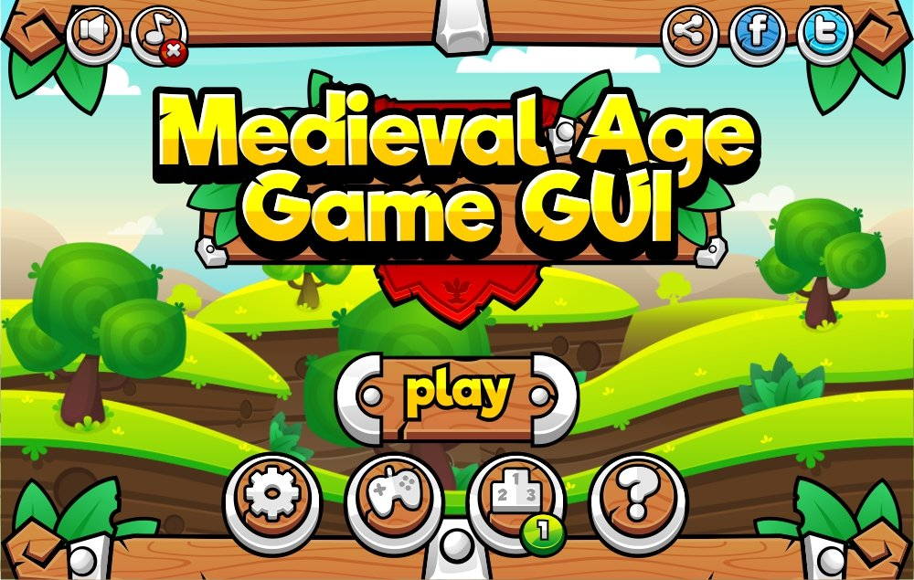

# 8. Stud Wood/Metal

Studs as rivets on wood or steel plates. Recipe: material texture + rivet ImageLabels. Refs: S, R16 (filter by texture).

Back to the [style catalog](../GUI-STYLES.md).

## Pictures

> Closest match found: cartoon wood-trim GUI, not studded.

*Medieval Age Game GUI* by pzUH, [source page](https://pzuh.itch.io/medieval-age-game-gui). Resized preview, all rights with the creator.

*Medieval Age Game GUI* by pzUH, [source page](https://pzuh.itch.io/medieval-age-game-gui). Resized preview, all rights with the creator.

## Find more references

- [Google Images](https://www.google.com/search?tbm=isch&q=roblox+Stud+Wood%2FMetal+gui)
- [Pinterest](https://www.pinterest.com/search/pins/?q=roblox+Stud+Wood%2FMetal+gui)
- [Behance](https://www.behance.net/search/projects?search=Stud+Wood%2FMetal+game+ui)
- [Dribbble](https://dribbble.com/search/Stud+Wood%2FMetal+game+ui)
- [Game UI Database](https://www.gameuidatabase.com/)
