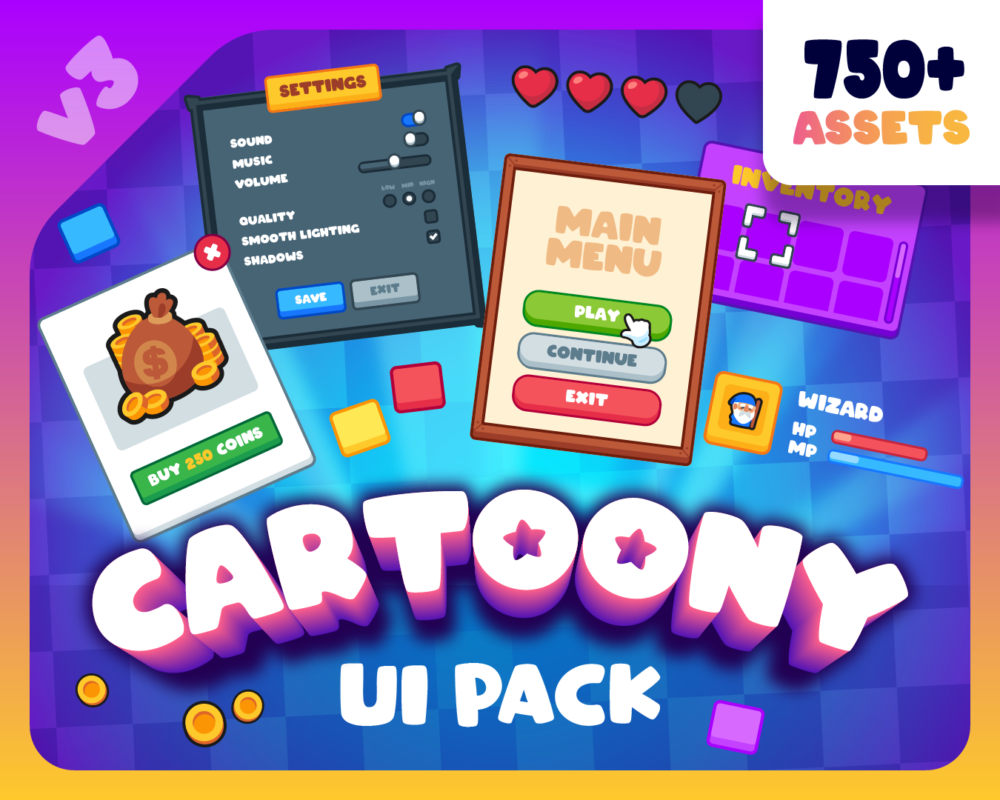

# 9. Modern Cartoon Simulator

Thick outline, saturated gradient fill, big rounded corners, bouncy buttons. Palette `#34C759 #FFB020 #3B2A6B`. Recipe: vertical UIGradient, UIStroke 4px, UICorner 14-20, scale tween on hover. Refs: R4 R9 R10.

Back to the [style catalog](../GUI-STYLES.md).

## Pictures

> gui-bundle-1 is a Roblox shop screenshot.

*GUI Bundle (Roblox)* by RoAssets, [source page](https://alexpoopy1.itch.io/gui-bundle). Resized preview, all rights with the creator.

*Cartoony UI Pack* by RhosGFX, [source page](https://rhosgfx.itch.io/cartoony-ui-pack). Resized preview, all rights with the creator.

## Find more references

- [Google Images](https://www.google.com/search?tbm=isch&q=roblox+Modern+Cartoon+Simulator+gui)
- [Pinterest](https://www.pinterest.com/search/pins/?q=roblox+Modern+Cartoon+Simulator+gui)
- [Behance](https://www.behance.net/search/projects?search=Modern+Cartoon+Simulator+game+ui)
- [Dribbble](https://dribbble.com/search/Modern+Cartoon+Simulator+game+ui)
- [Game UI Database](https://www.gameuidatabase.com/)
