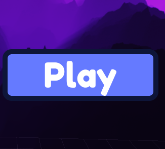

# 103. Settings Menu

Tabs (audio, graphics, controls), sliders, toggles, reset.

**Roblox recipe (from general Roblox knowledge, not tested in Studio):** Slider via InputChanged, persist with DataStore.

Back to the [catalog](../GUI-STYLES.md).

## Pictures

*Roblox Button UI Effects* by MaxUno, [source page](https://maxuno.itch.io/roblox-button-ui-effects). Preview image, all rights with the creator.

## Docs and references
- [Roblox docs: UI appearance modifiers](https://create.roblox.com/docs/en-us/ui/appearance-modifiers)
- [creation.dev: Roblox UI best practices](https://www.creation.dev/blog/roblox-ui-design-best-practices)

## Find more references
- [Google Images](https://www.google.com/search?tbm=isch&q=roblox+Settings+Menu+GUI+style)
- [YouTube](https://www.youtube.com/results?search_query=roblox+Settings+Menu+GUI+style)
- [Pinterest](https://www.pinterest.com/search/pins/?q=roblox+Settings+Menu+GUI+style)
- [Behance](https://www.behance.net/search/projects?search=Settings+Menu+GUI+style)
- [Dribbble](https://dribbble.com/search/Settings+Menu+GUI+style)
