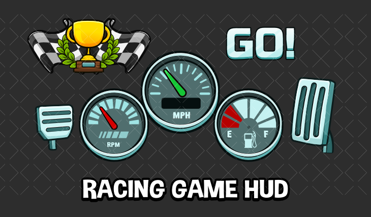

# 40. Futuristic Racing

Slanted speedometer, boost bar, italic numerals. Refs: R16.

Back to the [style catalog](../GUI-STYLES.md).

## Pictures

> Racing gauges and lights, the closest match for a speedometer-style HUD.

*Racing Game HUD* by gamedeveloperstudio, [source page](https://gamedeveloperstudio.itch.io/racing-game-hud). Resized preview, all rights with the creator.

*Racing Game HUD* by gamedeveloperstudio, [source page](https://gamedeveloperstudio.itch.io/racing-game-hud). Resized preview, all rights with the creator.

*Racing Game HUD* by gamedeveloperstudio, [source page](https://gamedeveloperstudio.itch.io/racing-game-hud). Resized preview, all rights with the creator.

## Find more references

- [Google Images](https://www.google.com/search?tbm=isch&q=roblox+Futuristic+Racing+gui)
- [Pinterest](https://www.pinterest.com/search/pins/?q=roblox+Futuristic+Racing+gui)
- [Behance](https://www.behance.net/search/projects?search=Futuristic+Racing+game+ui)
- [Dribbble](https://dribbble.com/search/Futuristic+Racing+game+ui)
- [Game UI Database](https://www.gameuidatabase.com/)
