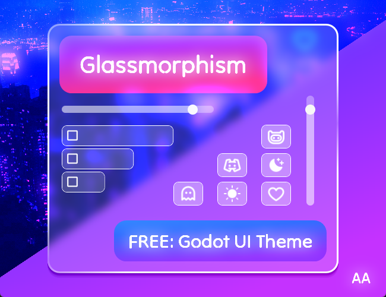
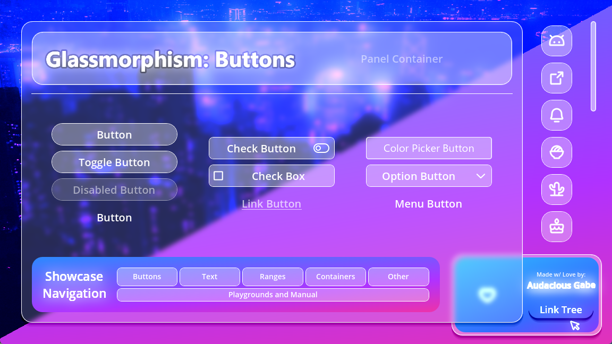

# 41. Glassmorphism

Translucent panels, 1px light border, soft shadow. Recipe: high-transparency Frame + UIStroke + subtle gradient. Real blur is limited in Roblox UI. Refs: S (no Roblox kit found).

Back to the [style catalog](../GUI-STYLES.md).

## Pictures

> Godot theme previews, shown as a visual reference for the look only.

*Audacious Assets: Glassmorphism UI (Godot)* by AudaciousGabe, [source page](https://audaciousgabe.itch.io/audacious-assets-glassmorphism). Resized preview, all rights with the creator.

*Audacious Assets: Glassmorphism UI (Godot)* by AudaciousGabe, [source page](https://audaciousgabe.itch.io/audacious-assets-glassmorphism). Resized preview, all rights with the creator.

*Audacious Assets: Glassmorphism UI (Godot)* by AudaciousGabe, [source page](https://audaciousgabe.itch.io/audacious-assets-glassmorphism). Resized preview, all rights with the creator.

## Find more references

- [Google Images](https://www.google.com/search?tbm=isch&q=roblox+Glassmorphism+gui)
- [Pinterest](https://www.pinterest.com/search/pins/?q=roblox+Glassmorphism+gui)
- [Behance](https://www.behance.net/search/projects?search=Glassmorphism+game+ui)
- [Dribbble](https://dribbble.com/search/Glassmorphism+game+ui)
- [Game UI Database](https://www.gameuidatabase.com/)
