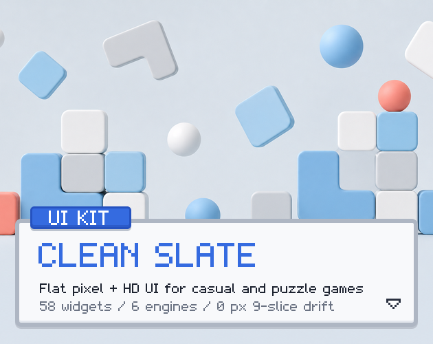
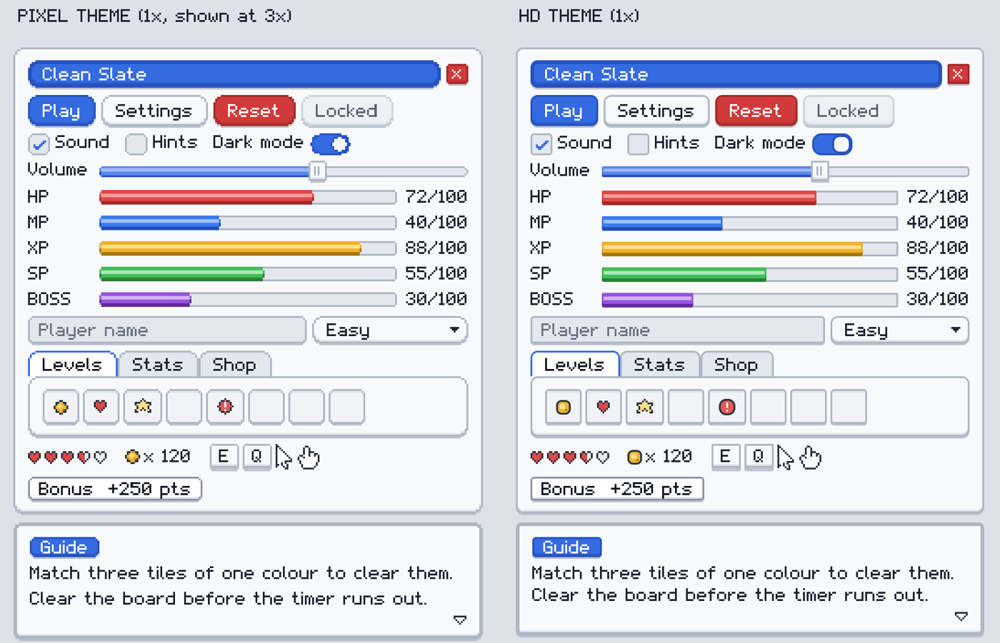

# 42. Flat Material

Solid colours, elevation shadows, 8px radius. Refs: R18.

Back to the [style catalog](../GUI-STYLES.md).

## Pictures

*Clean Slate: Modern Minimal UI Kit* by CSAF, [source page](https://csaf.itch.io/clean-slate-modern-minimal-ui-kit). Resized preview, all rights with the creator.

*Clean Slate: Modern Minimal UI Kit* by CSAF, [source page](https://csaf.itch.io/clean-slate-modern-minimal-ui-kit). Resized preview, all rights with the creator.

## Find more references

- [Google Images](https://www.google.com/search?tbm=isch&q=roblox+Flat+Material+gui)
- [Pinterest](https://www.pinterest.com/search/pins/?q=roblox+Flat+Material+gui)
- [Behance](https://www.behance.net/search/projects?search=Flat+Material+game+ui)
- [Dribbble](https://dribbble.com/search/Flat+Material+game+ui)
- [Game UI Database](https://www.gameuidatabase.com/)
