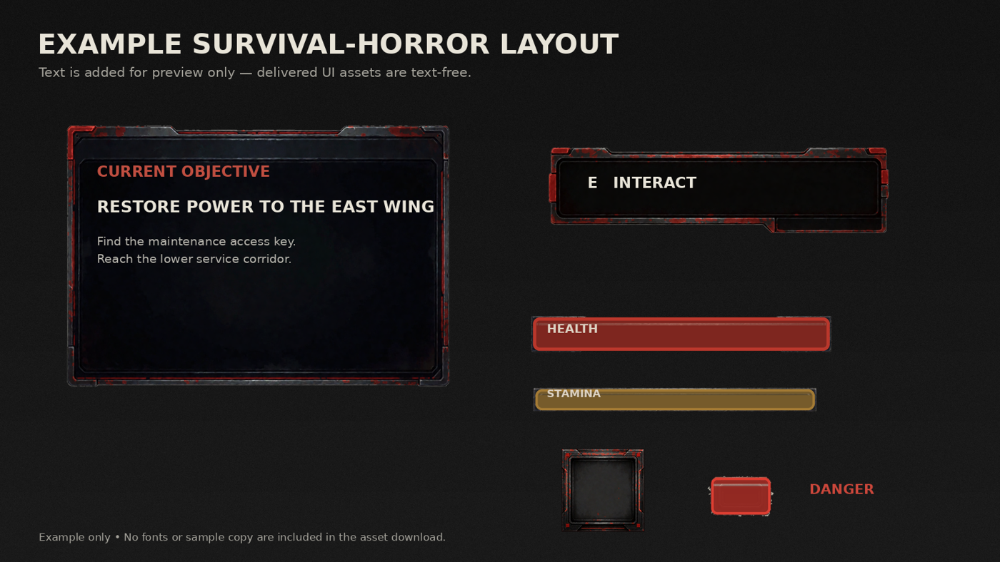

# 55. Minimal Survival HUD

Tiny vitals, vignette, nothing else. Refs: R18.

Back to the [style catalog](../GUI-STYLES.md).

## Pictures

*Survival Horror UI: Modular Interaction Kit* by Emre Karakaya, [source page](https://emrekarakaya.itch.io/survival-horror-ui-modular-interaction-kit). Resized preview, all rights with the creator.

*Survival Horror UI: Modular Interaction Kit* by Emre Karakaya, [source page](https://emrekarakaya.itch.io/survival-horror-ui-modular-interaction-kit). Resized preview, all rights with the creator.

*Survival Horror UI: Modular Interaction Kit* by Emre Karakaya, [source page](https://emrekarakaya.itch.io/survival-horror-ui-modular-interaction-kit). Resized preview, all rights with the creator.

## Find more references

- [Google Images](https://www.google.com/search?tbm=isch&q=roblox+Minimal+Survival+HUD+gui)
- [Pinterest](https://www.pinterest.com/search/pins/?q=roblox+Minimal+Survival+HUD+gui)
- [Behance](https://www.behance.net/search/projects?search=Minimal+Survival+HUD+game+ui)
- [Dribbble](https://dribbble.com/search/Minimal+Survival+HUD+game+ui)
- [Game UI Database](https://www.gameuidatabase.com/)
