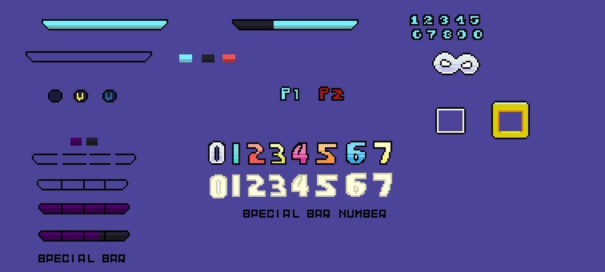

# 58. 8-bit Arcade

Chunky borders, score ticker, blinking prompts. Refs: R14.

Back to the [style catalog](../GUI-STYLES.md).

## Pictures

> Pixel HUD and arcade-style round banners.

*Neon Pixel HUD & UI Pack* by Hasthoth, [source page](https://hasthoth.itch.io/neon-pixel-hud-ui-pack). Resized preview, all rights with the creator.

*Fighting Game HUD/UI and Texts* by Richard Macedo, [source page](https://richard-macedo.itch.io/fighting-game-hudui-and-texts). Resized preview, all rights with the creator.

## Find more references

- [Google Images](https://www.google.com/search?tbm=isch&q=roblox+8-bit+Arcade+gui)
- [Pinterest](https://www.pinterest.com/search/pins/?q=roblox+8-bit+Arcade+gui)
- [Behance](https://www.behance.net/search/projects?search=8-bit+Arcade+game+ui)
- [Dribbble](https://dribbble.com/search/8-bit+Arcade+game+ui)
- [Game UI Database](https://www.gameuidatabase.com/)
