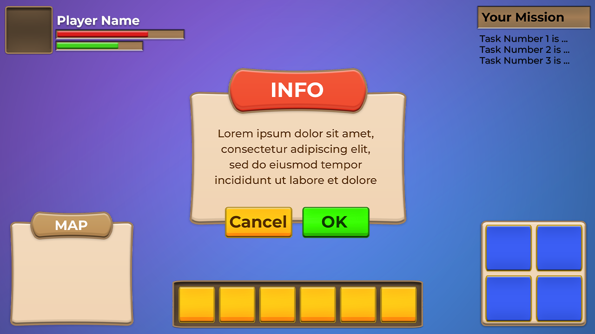

# 85. Cosmic Cartoon Space

Purple galaxy gradients, planets, chunky rounded cartoon outlines. Palette `#1B0B46 #6C3CF0 #FFD166`.

**Roblox recipe (from general Roblox knowledge, not tested in Studio):** Gradient + star particle ImageLabels, thick UIStroke.

Back to the [catalog](../GUI-STYLES.md).

## Pictures

*Casual Mobile Game UI Kit + 260 Icons* by SunGraphica, [source page](https://sungraphica.itch.io/casual-mobile-game-ui-kit-260-icons). Preview image, all rights with the creator.

## Docs and references
- [Roblox docs: UI appearance modifiers](https://create.roblox.com/docs/en-us/ui/appearance-modifiers)
- [creation.dev: Roblox UI best practices](https://www.creation.dev/blog/roblox-ui-design-best-practices)

## Find more references
- [Google Images](https://www.google.com/search?tbm=isch&q=roblox+Cosmic+Cartoon+Space+GUI+style)
- [YouTube](https://www.youtube.com/results?search_query=roblox+Cosmic+Cartoon+Space+GUI+style)
- [Pinterest](https://www.pinterest.com/search/pins/?q=roblox+Cosmic+Cartoon+Space+GUI+style)
- [Behance](https://www.behance.net/search/projects?search=Cosmic+Cartoon+Space+GUI+style)
- [Dribbble](https://dribbble.com/search/Cosmic+Cartoon+Space+GUI+style)
