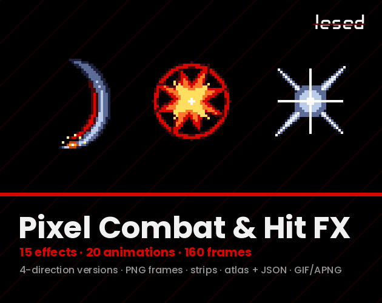

# 1. Hit Spark

Bright burst at the point of impact.

**Roblox recipe (from general Roblox knowledge, not tested in Studio):** ParticleEmitter, Lifetime 0.15-0.3, Rate 0, call Emit(8-15), LightEmission 1.

Back to the [catalog](../VFX.md).

## Pictures

*COMBAT FX* by GegX, [source page](https://gegx.itch.io/combat-fx). Preview image, all rights with the creator.

*Pixel Combat & Hit FX* by Lesed, [source page](https://lesed.itch.io/pixel-combat-hit-fx). Preview image, all rights with the creator.

## Docs and references
- [DevForum: Jad's Emit Plugin (VFX)](https://devforum.roblox.com/t/dear-vfx-makers-i-present-to-you-jads-emit-plugin/1986838)

## Find more references
- [Google Images](https://www.google.com/search?tbm=isch&q=roblox+Hit+Spark+vfx)
- [YouTube](https://www.youtube.com/results?search_query=roblox+Hit+Spark+vfx)
- [Pinterest](https://www.pinterest.com/search/pins/?q=roblox+Hit+Spark+vfx)
- [Behance](https://www.behance.net/search/projects?search=Hit+Spark+vfx)
- [Dribbble](https://dribbble.com/search/Hit+Spark+vfx)
