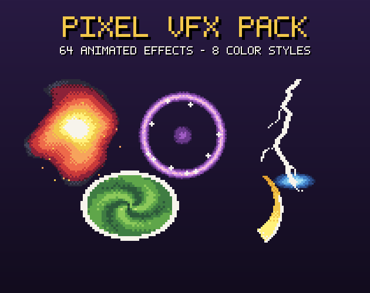

# 9. Magic Circle Cast

Rotating rune circle on the ground while casting.

**Roblox recipe (from general Roblox knowledge, not tested in Studio):** Decal/SurfaceGui image, tween Rotation, fade out.

Back to the [catalog](../VFX.md).

## Pictures

*Pixel VFX Pack, 64 Animated Effects* by Phzm, [source page](https://phzm.itch.io/pixel-vfx-pack). Preview image, all rights with the creator.

*Essential VFX Pack, 31 Animated Effects* by Bonkiloki, [source page](https://bonkiloki.itch.io/essential-vfx-pack-31-animated-effects). Preview image, all rights with the creator.

## Find more references
- [Google Images](https://www.google.com/search?tbm=isch&q=roblox+Magic+Circle+Cast+vfx)
- [YouTube](https://www.youtube.com/results?search_query=roblox+Magic+Circle+Cast+vfx)
- [Pinterest](https://www.pinterest.com/search/pins/?q=roblox+Magic+Circle+Cast+vfx)
- [Behance](https://www.behance.net/search/projects?search=Magic+Circle+Cast+vfx)
- [Dribbble](https://dribbble.com/search/Magic+Circle+Cast+vfx)
