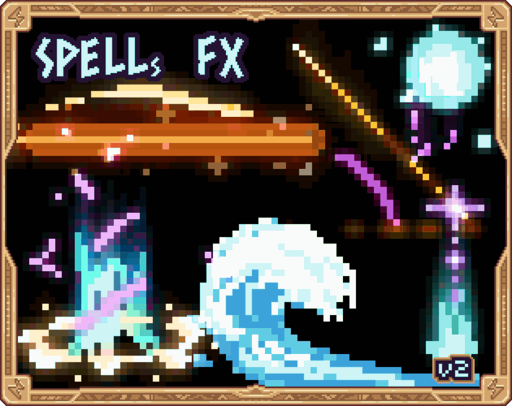

# 13. Water Splash

Droplets and ring on contact.

**Roblox recipe (from general Roblox knowledge, not tested in Studio):** emit droplets with gravity (Acceleration), ripple ring.

Back to the [catalog](../VFX.md).

## Pictures

*Spells FX* by RagnaPixel, [source page](https://ragnapixel.itch.io/spells-fx). Preview image, all rights with the creator.

## Find more references
- [Google Images](https://www.google.com/search?tbm=isch&q=roblox+Water+Splash+vfx)
- [YouTube](https://www.youtube.com/results?search_query=roblox+Water+Splash+vfx)
- [Pinterest](https://www.pinterest.com/search/pins/?q=roblox+Water+Splash+vfx)
- [Behance](https://www.behance.net/search/projects?search=Water+Splash+vfx)
- [Dribbble](https://dribbble.com/search/Water+Splash+vfx)
