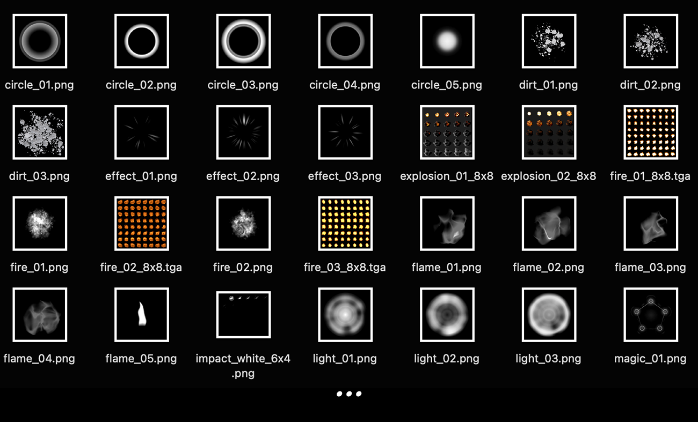

# 35. Particle Texture Library

Texture sheets for ParticleEmitters (sparks, smoke, rings, beams).

**Roblox recipe (from general Roblox knowledge, not tested in Studio):** use greyscale/white PNGs and tint with ColorSequence.

Back to the [catalog](../VFX.md).

## Pictures

*Particle Effect Texture Essentials* by Reactorcore, [source page](https://reactorcore.itch.io/particle-effect-texture-essentials). Preview image, all rights with the creator.

*Brackeys' VFX Bundle* by Brackeys, [source page](https://brackeysgames.itch.io/brackeys-vfx-bundle). Preview image, all rights with the creator.

## Docs and references
- [DevForum: Jad's Emit Plugin (VFX)](https://devforum.roblox.com/t/dear-vfx-makers-i-present-to-you-jads-emit-plugin/1986838)
- [DevForum: Tweening ParticleEmitter Size (NumberSequence)](https://devforum.roblox.com/t/trying-to-tween-a-particleemitters-size-numbersequence/647332)
- [DevForum: Tweening ParticleEmitter transparency](https://devforum.roblox.com/t/how-would-i-smoothly-tween-the-transparency-of-a-particle-emitter/829204)

## Find more references
- [Google Images](https://www.google.com/search?tbm=isch&q=roblox+Particle+Texture+Library+vfx)
- [YouTube](https://www.youtube.com/results?search_query=roblox+Particle+Texture+Library+vfx)
- [Pinterest](https://www.pinterest.com/search/pins/?q=roblox+Particle+Texture+Library+vfx)
- [Behance](https://www.behance.net/search/projects?search=Particle+Texture+Library+vfx)
- [Dribbble](https://dribbble.com/search/Particle+Texture+Library+vfx)
