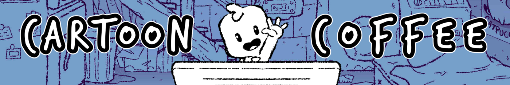

# 36. Cartoon VFX Spritesheets

Stylised cartoon burst, smoke and impact sheets.

**Roblox recipe (from general Roblox knowledge, not tested in Studio):** flipbook via ParticleEmitter FlipbookLayout.

Back to the [catalog](../VFX.md).

## Pictures

*Ultimate Cartoon VFX MEGA PACK* by CartoonCoffee, [source page](https://cartooncoffee.itch.io/megapack-spritesheets). Preview image, all rights with the creator.

*Ultimate Cartoon VFX MEGA PACK* by CartoonCoffee, [source page](https://cartooncoffee.itch.io/megapack-spritesheets). Preview image, all rights with the creator.

## Find more references
- [Google Images](https://www.google.com/search?tbm=isch&q=roblox+Cartoon+VFX+Spritesheets+vfx)
- [YouTube](https://www.youtube.com/results?search_query=roblox+Cartoon+VFX+Spritesheets+vfx)
- [Pinterest](https://www.pinterest.com/search/pins/?q=roblox+Cartoon+VFX+Spritesheets+vfx)
- [Behance](https://www.behance.net/search/projects?search=Cartoon+VFX+Spritesheets+vfx)
- [Dribbble](https://dribbble.com/search/Cartoon+VFX+Spritesheets+vfx)
